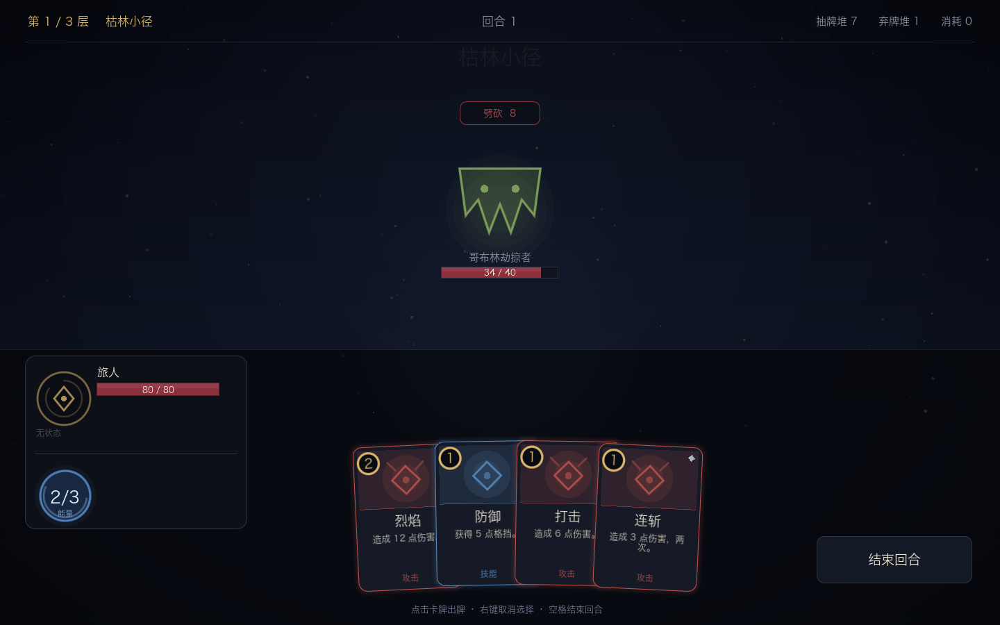

# 夜蚀 Nightfall · 卡牌构筑 Roguelike（原型）

对标《月圆之夜》的单机爬塔卡牌构筑游戏，Godot 4.5 实现。

当前版本是**战斗原型 + 双人合作模式**：单人三场连战，或两人同屏合作打 Boss（共享回合、互相掩护、合击加成、倒下复活）。
同一份工程可以导出**桌面版**和**Web 版**（Web 版可直接部署到自己的服务器）。

美术仍以代码绘制为主（`_draw`），已接入 31 枚 CC BY 3.0 卡牌效果图标与内置中文字体。



## 运行

```bash
# 直接启动（macOS，Godot 已安装）
~/Applications/Godot.app/Contents/MacOS/Godot --path "$(pwd)"
```

或用 Godot 编辑器：打开 `~/Applications/Godot.app` → Import → 选择本目录 → F5。

## 在线试玩

- 单人爬塔：**<https://uniqueonez.github.io/nightfall-card-game/>**
- 双人合作：**<https://uniqueonez.github.io/nightfall-card-game/?mode=coop>**

（GitHub Pages，国内首次加载约 1 分钟）

> 双人合作目前是**同屏热座**：两名玩家轮流操作，按 Tab 或点上方按钮切换。
> 联机版（各看各的屏幕）在网络层完成后开放。

## Web 版（可部署到服务器）

```bash
bash tools/build_web.sh           # 产物在 build/web/
cd build/web && python3 -m http.server 8080
```

部署到 Nginx / Docker / 静态托管的完整说明见 [deploy/README.md](deploy/README.md)。

## 操作

| 操作 | 说明 |
| --- | --- |
| 左键点卡牌 | 打出（需要目标的卡牌会进入选敌状态） |
| 左键点敌人 | 在选敌状态下确认目标 |
| 右键 / Esc | 取消选敌 |
| 空格 | 结束回合 |
| Tab | 双人模式切换当前操作玩家 |
| 结束回合按钮 | 同上 |

## 已实现

- 能量 / 抽牌堆 / 手牌 / 弃牌堆 / 消耗堆的完整循环，牌堆空时自动洗回
- 12 张卡：伤害、多段、格挡、力量、易伤、中毒、抽牌、治疗（消耗）
- 状态：力量、易伤、虚弱、中毒，含每回合衰减
- 敌方意图预告（攻击数值实时反映力量/虚弱），意图按 `pattern` 循环
- 三场战斗：哥布林 → 双石像鬼 → 深渊主教（Boss），层间回血
- 胜利/失败结算、继续深入、重开
- 确定性随机（固定 seed 可复现），事件流驱动全部动画

## 未实现（下一阶段）

- 分支地图、事件节点、商店、篝火、遗物、卡牌升级、卡牌奖励
- 5 职业 × 300 卡的内容（规划见 [docs/内容规划_5职业300卡.md](docs/内容规划_5职业300卡.md)）
- 存档与元进度、音频、卡面美术替换
- 设置界面、多语言

## 素材与授权

全部为可商用授权，清单见 [assets/LICENSES.md](assets/LICENSES.md)：

| 资源 | 授权 |
| --- | --- |
| 卡牌效果图标 31 枚（game-icons.net） | CC BY 3.0，需署名 |
| 中文字体 Noto Sans SC | SIL OFL 1.1 |

待接入的 CC0 包（Kenney UI / 卡框 / 音效 / 怪物图）已在授权文件中登记。

## 目录

```
assets/          字体、图标、授权文件
build/web/       Web 导出产物（gitignore）
deploy/          Nginx / Docker 部署配置
data/            卡牌与敌人数据（JSON，改完即生效）
scenes/main.tscn 唯一场景，UI 由脚本构建
scripts/core/    纯逻辑战斗引擎（不依赖节点，可单测）
scripts/data/    数据加载（autoload DB）
scripts/ui/      表现层：主题、卡牌、单位、玩家面板、背景
scripts/         game_state.gd（一局 Run 的状态，autoload Game）
tests/           无头规则测试
tools/           构建与导出脚本
docs/            技术方案、5 职业 300 卡内容规划
```

## 测试

```bash
~/Applications/Godot.app/Contents/MacOS/Godot --headless --path . --script res://tests/test_battle.gd
```

61 项断言，覆盖伤害公式、格挡、能量限制、状态、抽牌洗牌、敌人意图推进、胜负判定，
以及 30 组随机种子的整局自动对战（防卡死）。

## 自动演示（无头）

```bash
# 自动打完第一场，输出结算信息
Godot --headless --path . -- --auto
# 自动连打三场
Godot --headless --path . -- --autoall
```

技术细节见 [docs/技术方案.md](docs/技术方案.md)。
